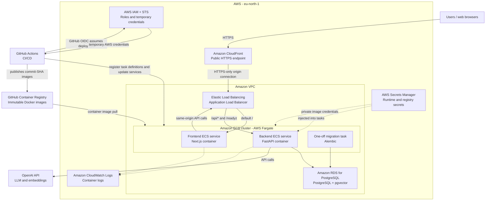

# FinSight-AI AWS Technology Inventory

This is a historical AWS architecture inventory and a description of the deployment design retained in the repository. As of **October 31, 2026**, the previous AWS account is closed. No resources, endpoints, network controls or production deployment are asserted active or verified. Infrastructure validation is blocked and must be repeated before any future deployment.

The diagrams and service descriptions below are portfolio/design evidence, not an operational status report. No AWS account recovery, provisioning, deployment or paid infrastructure work is authorized. Future hosting will be evaluated separately under a strict cost budget; no VPS hosting has been implemented.

## Architecture at a glance

## Historical services and repository-supported design

| AWS technology | Historical role / repository-supported design |
| --- | --- |
| **Amazon CloudFront** | Provides the public HTTPS endpoint and redirects viewers from HTTP to HTTPS. It forwards traffic to the ALB origin. |
| **Elastic Load Balancing - Application Load Balancer (ALB)** | Routes `/api/*` and `/readyz` to the backend target group; all other paths go to the frontend target group. |
| **Amazon Elastic Container Service (ECS)** | Runs separate frontend and backend services and stores their task definitions. Resource names stay in protected deployment variables. |
| **AWS Fargate** | Supplies serverless compute for the ECS containers and for one-off backend database-migration tasks. |
| **Amazon RDS for PostgreSQL** | Hosts the production relational database. The application uses PostgreSQL and the `vector` extension for pgvector embeddings and similarity search. |
| **Amazon VPC** | Provides the network boundary for the ALB, ECS tasks, and RDS. The historical ALB design used two subnets, and ECS uses `awsvpc` networking with subnets and security groups. |
| **AWS Secrets Manager** | Injects `DATABASE_URL`, `OPENAI_API_KEY`, `JWT_SECRET_KEY`, and `JWT_REFRESH_SECRET_KEY` into the backend task. It can also supply private GHCR pull credentials. |
| **Amazon CloudWatch Logs** | Receives frontend and backend container logs from ECS task definitions. |
| **AWS Identity and Access Management (IAM)** | Controls the GitHub deployment role, ECS task execution/task roles, `iam:PassRole`, and access to ECS and Secrets Manager. |
| **AWS Security Token Service (STS) / GitHub OIDC federation** | Lets GitHub Actions assume the deployment role with short-lived credentials instead of storing long-lived AWS access keys. |
| **AWS IAM Identity Center** | Provides human AWS CLI access through the `finsight-ai` SSO profile. |
| **AWS CLI** | Used by operators and the deployment workflow to inspect/register ECS task definitions, run migrations, update services, and wait for service stability. |

## Deployment resource configuration

| Resource | Configuration source |
| --- | --- |
| AWS Region | `AWS_REGION` |
| CloudFront endpoint | `PUBLIC_APP_URL` |
| HTTPS ALB origin | `ORIGIN_HTTPS_URL` |
| ECS cluster | `ECS_CLUSTER` |
| Frontend ECS service | `ECS_FRONTEND_SERVICE` |
| Backend ECS service | `ECS_BACKEND_SERVICE` |
| Frontend task family | `ECS_FRONTEND_TASK_FAMILY` |
| Backend task family | `ECS_BACKEND_TASK_FAMILY` |
| CloudFront distribution | `CLOUDFRONT_DISTRIBUTION_ID` |
| RDS instance | `RDS_DB_INSTANCE_ID` |
| RDS engine/port | PostgreSQL on `5432` |
| Deployment IAM role | `FinSightGitHubActionsDeployRole` |

## Retained deployment design (not currently operational)

1. GitHub Actions tests the Python and Node.js applications, builds both Docker images, and scans them with Trivy.
2. Successful `master` builds are published to GHCR with an immutable Git commit SHA tag.
3. Only after a separately authorized manual dispatch, `AWS_DEPLOY_ENABLED=true` and production approval/configuration checks, the workflow exchanges its GitHub OIDC token for temporary AWS credentials by assuming an IAM role.
4. It registers a new backend ECS task definition, runs `alembic upgrade head` as a one-off Fargate task, and updates the backend service.
5. It registers a new frontend ECS task definition and updates the frontend service.
6. ECS sends container logs to CloudWatch Logs, while the workflow waits for service stability and runs public smoke checks.

## Production release controls

The retained workflow checks end-to-end TLS, CloudFront WAF, private encrypted Multi-AZ RDS and private encrypted S3 storage before its deployment steps. These checks have not been run against an operational AWS account in this cycle. The workflow is manual-only; normal CI or a merge cannot deploy. GitHub environment approval enforcement and stored variable values are not inferred from YAML.

## Additional AWS services

These are implemented storage/runtime requirements or additional design options; none are claimed deployed:

| Technology | Status and intended purpose |
| --- | --- |
| **Amazon S3** | S3 storage integration is implemented and required by the current production configuration; no live bucket is asserted. |
| **Amazon ElastiCache for Redis** | Redis is required in production; the managed ElastiCache service is a hosting option, not an application requirement or an active resource. |
| **AWS Certificate Manager (ACM)** | Certificates for HTTPS between viewers, CloudFront, and the ALB. |
| **Amazon Route 53 / custom domain** | DNS and domain validation needed for end-to-end TLS. |
| **Additional ECS worker service** | Future worker option. Upload processing is request-bound; no production ARQ worker is currently implemented. |

## Related repository files

- [`README.md`](README.md) - project overview, local setup and current non-deployed status.
- [`docs/15-aws-cicd.md`](docs/15-aws-cicd.md) - detailed AWS setup, security posture, and operational notes.
- [`.github/workflows/deploy-aws.yml`](.github/workflows/deploy-aws.yml) - executable AWS deployment workflow.
- [`.github/workflows/ci.yml`](.github/workflows/ci.yml) - test, build, scan, and image-publishing pipeline.
