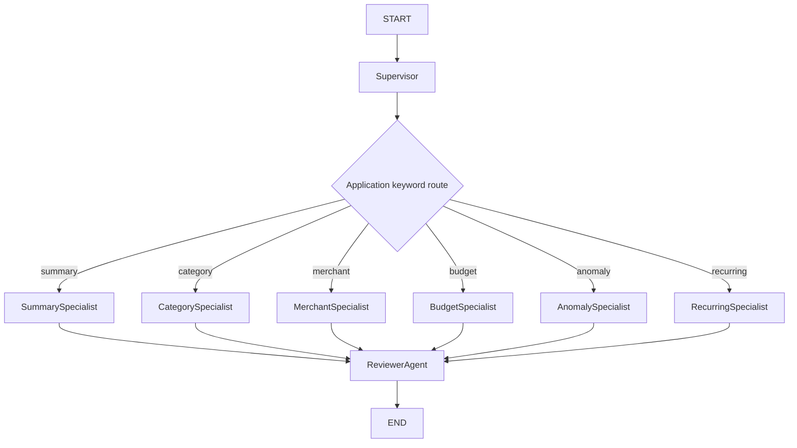

# 4. LangGraph Graph Design

## Graph

## Tool Policy

The application calls the following financial methods. They are not OpenAI function-calling tools, and they do not all have individual public API endpoints:

- `get_transactions` (internal helper; no dedicated chat lookup intent)
- `get_monthly_summary`
- `compare_months`
- `get_spending_by_category`
- `detect_anomalies`
- `generate_budget`
- `get_top_merchants`
- `get_recurring_payments`

## Implementation Note

`OrchestratorAgent` executes the graph above. It retrieves user-scoped RAG chunks before graph invocation, then executes one tool branch and a reviewer. Current financial outputs carry `_evidence`; the LLM receives allowed claim IDs, and the reviewer composes the answer from verified tool facts. Retrieved documents do not supply answers or citations in that path.

Document question answering, source-citation responses and LLM-controlled function calling are not implemented routes. Internal evaluation uses local-hash retrieval and mocked model responses; it is not evidence of live semantic document-answer quality. Tests can execute the graph without external provider calls.
