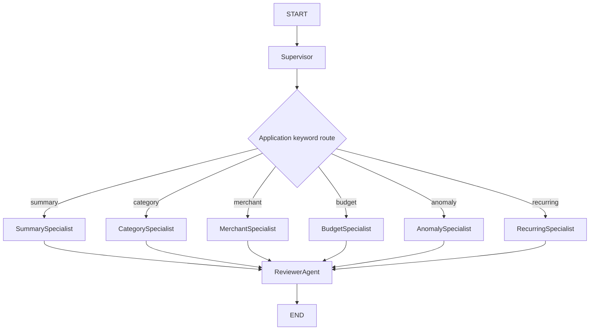

# 4. LangGraph Graph Design

## Graph

## Tool Policy

The application calls the following financial methods. They are not OpenAI function-calling tools, and they do not all have individual public API endpoints:

- `get_transactions` (internal helper; no dedicated chat lookup intent)
- `get_monthly_summary`
- `compare_months`
- `get_spending_by_category`
- `detect_anomalies`
- `generate_budget`
- `get_top_merchants`
- `get_recurring_payments`

## Implementation Note

`OrchestratorAgent` executes the graph above. It retrieves user-scoped RAG chunks before graph invocation, then executes one tool branch and a reviewer. Current financial outputs carry `_evidence`; the LLM receives allowed claim IDs, and the reviewer composes the answer from verified tool facts. Retrieved documents do not supply answers or citations in that path.

Document question answering and source-citation responses are implemented outside this graph through authenticated, user-scoped service/API paths. Citation references are checked against retrieved authorized chunks, while semantic grounding remains explicitly unverified. LLM-controlled function calling is not implemented. Offline CI evaluation uses local-hash retrieval and mocked model responses; a separate opt-in real-model harness exists, but no live result is implied by deterministic test success. Tests can execute the graph without external provider calls.
